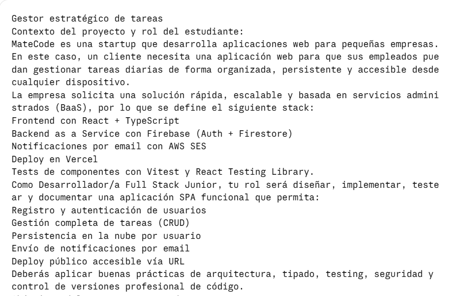

# Gestor Estratégico de Tareas

Aplicación web SPA para que los empleados de una pequeña empresa gestionen sus tareas diarias de forma organizada, persistente y accesible desde cualquier dispositivo. Proyecto integrador de MateCode.

🔗 **URL de producción:** https://proyecto-m4-jeremias-duin.vercel.app

📦 **Repositorio:** https://github.com/jereduin10/proyectoM4_JeremiasDuin

## Funcionalidades

- Registro, login y logout con email y contraseña o con Google
- Rutas privadas: las tareas solo se ven con sesión iniciada
- CRUD de tareas (título, descripción, prioridad, fecha de vencimiento)
- Marcar tareas como completadas
- Filtros (todas, pendientes, completadas) y orden (recientes, prioridad, vencimiento)
- Actualización en tiempo real de la lista
- Envío por email de un resumen del estado de las tareas
- Diseño responsive, mobile first

## Stack

| Capa | Tecnología |
|---|---|
| Frontend | React + TypeScript (Vite), Tailwind CSS, React Router |
| Backend as a Service | Firebase Authentication + Cloud Firestore |
| Email | AWS SES, invocado desde una Vercel Function |
| Testing | Vitest + React Testing Library |
| Deploy | Vercel |

## Estructura del proyecto

```
gestor-tareas/
├── api/
│   └── send-summary.ts          Vercel Function: verifica el token y envía con SES
├── docs/
│   └── screenshots/             Capturas del README
├── public/
├── src/
│   ├── components/
│   │   ├── AuthForm.tsx
│   │   ├── AuthForm.test.tsx
│   │   ├── ProtectedRoute.tsx
│   │   ├── SendSummaryButton.tsx
│   │   ├── SendSummaryButton.test.tsx
│   │   ├── TaskFilters.tsx
│   │   ├── TaskFilters.test.tsx
│   │   ├── TaskForm.tsx
│   │   ├── TaskForm.test.tsx
│   │   ├── TaskItem.tsx
│   │   ├── TaskList.tsx
│   │   └── TaskList.test.tsx
│   ├── context/
│   │   ├── authContext.ts
│   │   └── AuthProvider.tsx
│   ├── hooks/
│   │   ├── useAuth.ts
│   │   └── useTasks.ts
│   ├── pages/
│   │   ├── LoginPage.tsx
│   │   ├── RegisterPage.tsx
│   │   └── TasksPage.tsx
│   ├── services/
│   │   ├── authService.ts
│   │   ├── emailService.ts
│   │   ├── firebase.ts
│   │   └── taskService.ts
│   ├── test/
│   │   ├── factories.ts
│   │   └── setup.ts
│   ├── types/
│   │   └── task.ts
│   ├── utils/
│   │   ├── taskUtils.ts
│   │   └── taskUtils.test.ts
│   ├── App.tsx
│   ├── index.css
│   └── main.tsx
├── .env                         Local, NO se sube a GitHub
├── .env.example
├── .gitignore
├── eslint.config.js
├── index.html
├── package.json
├── package-lock.json
├── README.md
├── tsconfig.json
├── tsconfig.app.json
├── tsconfig.node.json
├── vercel.json
└── vite.config.ts
```

## Decisiones arquitectónicas

- **Capas separadas:** los componentes no hablan con Firebase; lo hacen los `services`, que consumen los `hooks`. Esto simplifica los tests y los mocks.
- **Colección `tasks` con campo `userId`** (en lugar de subcolecciones por usuario): consultas simples y alineadas con el requisito de filtrar por `userId`.
- **Tiempo real con `onSnapshot`:** la UI se actualiza sola tras cada operación, incluso entre pestañas.
- **Reglas de seguridad de Firestore:** cada usuario solo puede leer y escribir sus propias tareas, sin depender del frontend.
- **Un único `TaskForm` para crear y editar:** menos código duplicado y más fácil de testear.
- **Funciones puras para filtrar y ordenar** (`utils/taskUtils.ts`), cubiertas con tests unitarios.
- **Contexto de autenticación** con estado de carga, para no redirigir al login por error al recargar.
- **Secretos solo en el servidor:** las claves de AWS nunca llegan al navegador.

## Instalación

Requisitos: Node.js, un proyecto de Firebase (Auth con email y Google, y Firestore) y una cuenta de AWS con una identidad verificada en SES.

```bash
git clone https://github.com/jereduin10/proyectoM4_JeremiasDuin
cd proyectoM4_JeremiasDuin
npm install
cp .env.example .env
npm run dev
```

Otros comandos:

```bash
npm run test:run   # corre los tests una vez
npm run build      # build de producción
```

> `npm run dev` no ejecuta la carpeta `api/`. El envío de email se prueba en la versión desplegada en Vercel.

## Variables de entorno

| Variable | Dónde se usa | Descripción |
|---|---|---|
| `VITE_FIREBASE_API_KEY` | Frontend | Configuración de Firebase |
| `VITE_FIREBASE_AUTH_DOMAIN` | Frontend | Configuración de Firebase |
| `VITE_FIREBASE_PROJECT_ID` | Frontend | Configuración de Firebase |
| `VITE_FIREBASE_STORAGE_BUCKET` | Frontend | Configuración de Firebase |
| `VITE_FIREBASE_MESSAGING_SENDER_ID` | Frontend | Configuración de Firebase |
| `VITE_FIREBASE_APP_ID` | Frontend | Configuración de Firebase |
| `FIREBASE_PROJECT_ID` | Servidor | Valida los tokens de Firebase en la función |
| `SES_ACCESS_KEY_ID` | Servidor | Credencial de AWS (usuario IAM solo con `ses:SendEmail`) |
| `SES_SECRET_ACCESS_KEY` | Servidor | Credencial de AWS |
| `SES_REGION` | Servidor | Región de SES (`us-east-2`) |
| `SES_FROM_EMAIL` | Servidor | Remitente verificado en SES |

Las variables con prefijo `VITE_` quedan incluidas en el código del navegador. El resto solo existe en el servidor. El archivo `.env` está en `.gitignore`.

## Flujo de envío de emails

1. El usuario toca **Enviar resumen por email**.
2. El frontend obtiene el token de Firebase del usuario y llama a `POST /api/send-summary` con las tareas.
3. La Vercel Function **verifica el token** contra las claves públicas de Google y toma el destinatario **del token**, no del navegador.
4. Valida los datos recibidos y arma un email en texto plano.
5. Envía el correo con AWS SES y responde al frontend, que muestra éxito o error.

**Limitación:** SES está en modo *sandbox*, así que solo envía a direcciones verificadas. Para usarlo con cualquier destinatario hay que solicitar el acceso a producción en AWS.

## Uso de IA en el desarrollo

**Cómo la integré:** Primero le envié las instrucciones del proyecto:



Luego le di indicaciones sobre la misma:

"Soy principiante y debo hacer ese proyecto. Ayudame a armarlo con breves explicaciones de lo que estamos haciendo y consultandome por la arquitectura y decisiones importantes del proyecto. Lo voy a hacer con visual studio code".

La **primera decisión** antes de arrancar fue cual método de autenticación implementar y el mismo fue Email/password + Google.

La **segunda decisión** fue definir que datos tiene una tarea los cuales fueron :id, userId, title, description, completed, createdAt y además agregué los extras opcionales de la consigna como: fecha de vencimiento y prioridad.

**Tercera decisión**: cómo se actualiza la lista de tareas. Decidí la opción de: Tiempo real (onSnapshot): Firestore avisa solo cada vez que algo cambia, y la lista se actualiza sin hacer nada. Es menos código y más fluido. Además sincroniza entre pestañas o dispositivos.

**Cuarta decisión**: Cómo se edita una tarea. Se reutiliza el formulario de arriba. Al tocar “Editar”, el TaskForm se llena con los datos de esa tarea y el botón pasa a decir “Guardar cambios”. Es un solo componente para crear y editar, con menos código y más fácil de testear.

**Situaciones donde fue más efectiva:**
- Definir la arquitectura por capas y explicar el porqué de cada decisión.
- Escribir los tests y entender cómo mockear servicios externos.
- Configurar AWS SES, IAM y Vercel, que eran terrenos nuevos para mí.

**Patrones y buenas prácticas que descubrí:**
- Probar cada paso antes de avanzar, en lugar de acumular cambios.
- Dar contexto: el error completo, capturas, el archivo y el paso en el que estaba.
- Nunca compartir claves ni secretos con la IA.
- Revisar lo que se copia hasta entenderlo: por ejemplo, verifiqué que `.env` no estuviera en el historial de Git.

## Autor

Jeremias Duin · https://github.com/jereduin10 · Proyecto integrador Módulo 4.